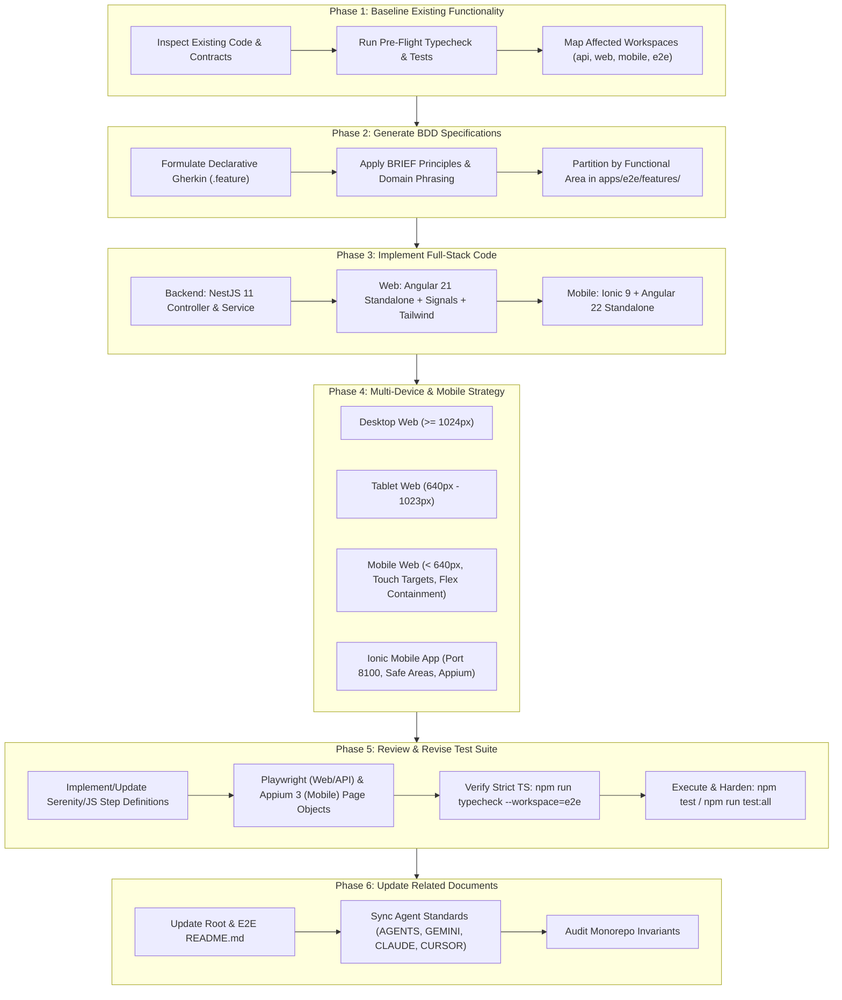

# Feature Implementation Workflow Standard

This skill defines the canonical 6-phase engineering lifecycle for implementing features, enhancements, and bug fixes across the **Charlotte Wealth** monorepo. All AI coding agents (Claude, Codex, Gemini/Antigravity, Cursor) must follow this workflow to guarantee architectural consistency, multi-device resilience, and 100% test pass rates.

---

## 🏛️ The 6-Phase Feature Lifecycle



---

## 🔍 Phase 1: Baseline Existing Functionality

Before modifying code or creating new files, establish a solid understanding of the current baseline:

### 1.1 Pre-Flight Quality Gate
Always run existing checks to ensure the codebase is healthy before introducing changes:
```bash
# Verify TypeScript strictness in e2e
npm run typecheck --workspace=e2e

# Run baseline test suite for the affected domain
npm run test:api       # If changing backend/API contracts
npm run test:web       # If changing web frontend
npm run test:mobile    # If changing mobile frontend
```

### 1.2 Inspect Current-State Artifacts
1. **API Contracts (`apps/api`)**:
   - Inspect existing controller routes, HTTP methods (`GET`, `POST`, `PUT`, `DELETE`), query parameters, and DTOs.
   - Note security requirements (e.g., `X-API-Key` headers on protected routes).
2. **Frontend State & Components (`apps/web` & `apps/mobile`)**:
   - Inspect existing Angular Signals (`signal`, `computed`), inputs, outputs, and model bindings.
   - Inspect CSS variables (`--color-surface`, `--color-accent`) and theme directives (`data-theme="dark"`).
3. **Existing BDD Scenarios (`apps/e2e/features/`)**:
   - Check if an existing feature file already covers the functional area. Avoid duplicate scenarios; extend existing files or create cleanly grouped additions.

---

## 🥒 Phase 2: Generate BDD Specifications (Shift-Left)

Author executable Gherkin specifications **before** implementing features. Refer to the [**`cucumber-bdd`** skill](file:///c:/dev/charlotte-wealth/.agents/skills/cucumber-bdd/SKILL.md) for full syntax and standards.

### 2.1 File Partitioning by Functional Area
All `.feature` files are strictly organized by domain under `apps/e2e/features/`:

```text
apps/e2e/features/
├── api/          # Backend API contracts & calculations (@api)
├── web/          # Angular Web dashboard & views (@web)
└── mobile/       # Ionic Mobile views & Appium automation (@mobile)
```

### 2.2 Golden Rules of Specification Authoring
* **Apply BRIEF Principles**:
  - **B**usiness language: Describe *what* happens in user terminology, not *how* buttons are clicked.
  - **R**eal data: Use realistic figures (`$150.00`, `AAPL`, `100 shares`).
  - **I**ntention-revealing: State the goal, not the mechanical interaction.
  - **E**ssential details only: Omit CSS selectors, URLs, and low-level clicks from Gherkin.
  - **F**ocused on one behavior: Each scenario verifies one concrete outcome.
* **Declarative Phrasing**:
  ```gherkin
  # ❌ BAD: Imperative / mechanical
  When I click on "#privacy-toggle-btn"
  And I wait 500ms
  Then element "#net-worth" should have class "privacy-mask"

  # ✅ GOOD: Declarative / business-focused
  When "Charlotte" toggles Privacy Mode
  Then portfolio sensitive values should be masked
  ```
* **Suite Hygiene**:
  - 5 to 10 scenarios per `.feature` file.
  - 3 to 5 steps per scenario.
  - Tag every scenario with its domain tag (`@api`, `@web`, or `@mobile`) and functional tags (`@smoke`, `@holdings`, `@tools`, `@analytics`).

---

## 💻 Phase 3: Implement Full-Stack Code

Implement changes cleanly following domain-specific standards:

### 3.1 Backend REST API (`apps/api`)
* **NestJS 11 Architecture**: Follow the [**`nestjs-api`** skill](file:///c:/dev/charlotte-wealth/.agents/skills/nestjs-api/SKILL.md).
* Keep controllers thin; place wealth calculations, FIFO lot logic, and data manipulation in services.
* Enforce strict typing on DTOs and controller return signatures.
* Ensure CORS remains open to both `http://localhost:4200` (Web) and `http://localhost:8100` (Mobile).

### 3.2 Frontend Web Application (`apps/web`)
* **Angular 21 Standalone**: Follow the [**`angular-development`** skill](file:///c:/dev/charlotte-wealth/.agents/skills/angular-development/SKILL.md).
* Use Standalone Components (`imports: [...]`), **never** `NgModule`.
* Use Signals (`signal()`, `computed()`) for reactive state management.
* Style using Tailwind CSS v4 directives and CSS theme variables.

### 3.3 Frontend Mobile Application (`apps/mobile`)
* **Ionic 9 + Angular 22 Standalone**:
* Structure screens with touch-friendly wealth cards and segmented sub-view controls.
* Use explicit CSS styling for icons and components (avoid assuming Web-only Tailwind utility classes exist in mobile).

---

## 📱 Phase 4: Multi-Device & Mobile Strategy

Charlotte Wealth runs across three distinct browser form factors and a hybrid mobile app. Every frontend change must be designed for all four viewports:

| Form Factor | Viewport Width | Navigation Pattern | Layout & Typography | Key Constraints |
| :--- | :--- | :--- | :--- | :--- |
| **Desktop Web** | `>= 1024px` | Full horizontal tab bars | Multi-column grids (3–4 cards), data tables | Hover interactions, full modals |
| **Tablet Web** | `640px – 1023px` | Collapsible sidebar / segmented tabs | 2-column grids, scrollable table wraps | Touch targets, responsive modals |
| **Mobile Web** | `< 640px` | Dropdown or bottom drawer trigger | Single-column stacked cards, compact font | Horizontal overflow scrolling, flex containment |
| **Ionic Mobile App** | Mobile viewport (Port `8100`) | Mobile header + bottom tabs | Native wealth cards, segmented mode pills | Safe area insets, Appium automation locators |

### 4.1 Mobile-First Engineering Rules
1. **Flexbox Containment (`min-width: 0`)**:
   Always apply `min-width: 0; width: 100%;` to flex child containers (such as `.card-title-group` or `.div-title-group`). Without `min-width: 0`, flex children expand to fit content, causing horizontal scrollbar bugs on mobile.
2. **Explicit Icon Sizing**:
   Never rely solely on Tailwind utility classes (e.g. `w-6 h-6`) in the mobile workspace. Always provide explicit CSS rules:
   ```css
   .title-icon,
   .title svg {
     width: 1.5rem;
     height: 1.5rem;
     min-width: 1.5rem;
     flex-shrink: 0;
   }
   ```
3. **Touch Targets**:
   Interactive elements (buttons, pills, tabs) must have a minimum touch target of **44x44px** on mobile devices.
4. **Horizontal Pill Bars**:
   When rendering multi-category pill selectors on mobile:
   ```css
   .filter-pills {
     width: 100%;
     display: flex;
     overflow-x: auto;
     -webkit-overflow-scrolling: touch;
     scrollbar-width: none; /* Hide scrollbar for clean UI */
   }
   .filter-pills::-webkit-scrollbar {
     display: none;
   }
   ```
5. **Safe Area Insets**:
   Account for notch and status bar spacing on iOS and Android:
   ```css
   padding-top: max(0.75rem, env(safe-area-inset-top));
   padding-bottom: max(0.75rem, env(safe-area-inset-bottom));
   ```

---

## 🧪 Phase 5: Review & Revise Test Suite

Connect Gherkin specifications to test automation and harden execution:

### 5.1 Architecture Stack
* **Web & API**: **Playwright** ([`web_portfolio.page.ts`](file:///c:/dev/charlotte-wealth/apps/e2e/playwright/pageobjects/web_portfolio.page.ts), [`web.steps.ts`](file:///c:/dev/charlotte-wealth/apps/e2e/features/step_definitions/web.steps.ts), [`api.steps.ts`](file:///c:/dev/charlotte-wealth/apps/e2e/features/step_definitions/api.steps.ts)).
* **Mobile**: **Appium 3 & WebdriverIO 10** ([`appium_session.ts`](file:///c:/dev/charlotte-wealth/apps/e2e/appium/driver/appium_session.ts), [`mobile_portfolio.page.ts`](file:///c:/dev/charlotte-wealth/apps/e2e/appium/pageobjects/mobile_portfolio.page.ts), [`mobile.steps.ts`](file:///c:/dev/charlotte-wealth/apps/e2e/features/step_definitions/mobile.steps.ts)).
* **Reporting**: **Serenity/JS** Screenplay pattern ([`setup.ts`](file:///c:/dev/charlotte-wealth/apps/e2e/features/support/setup.ts)).

### 5.2 Step Definition Best Practices
1. **Avoid Arbitrary Sleep/Pause**:
   Do not use hardcoded `pause(5000)`. Use event-driven waits:
   ```typescript
   // Playwright (Web)
   await expect(page.locator('#dashboard-card')).toBeVisible({ timeout: 5000 });

   // WebdriverIO (Mobile)
   await element.waitForDisplayed({ timeout: 5000 });
   await browser.waitUntil(async () => (await element.getText()).includes(expected), {
     timeout: 5000,
     timeoutMsg: `Expected element text to update`
   });
   ```
2. **Session Lifecycle Management**:
   - Launch browser/device sessions in `BeforeAll` and close them in `AfterAll`.
   - Re-use sessions across scenarios to achieve sub-second scenario execution times (e.g. ~100ms per scenario instead of 5s per browser launch).
3. **Appium Reachability Fallback**:
   In [`appium_session.ts`](file:///c:/dev/charlotte-wealth/apps/e2e/appium/driver/appium_session.ts), probe port `4723` with a socket check before connecting. If the Appium daemon is offline, fall back cleanly to local Chrome mobile viewport emulation to avoid connection timeout errors.

### 5.3 Quality Verification Checklist
Execute all verification commands before committing:
```bash
# 1. Strict TypeScript check
npm run typecheck --workspace=e2e

# 2. Domain-specific runs
npm run test:api
npm run test:web
npm run test:mobile

# 3. Full unified regression run
npm test
```
* Ensure **100% of scenarios pass** (0 failed, 0 broken).
* Inspect Serenity/JS living reports in `apps/e2e/target/site/serenity/` and `apps/e2e/target/cucumber-report.html`.

---

## 📚 Phase 6: Update Related Documents

After completing implementation and verifying test passes, synchronize all documentation:

### 6.1 Documentation Synchronization Checklist
| Document | Location | When to Update |
| :--- | :--- | :--- |
| **Root README** | [`README.md`](file:///c:/dev/charlotte-wealth/README.md) | Feature matrix, new commands, architectural changes, skills catalog. |
| **E2E README** | [`apps/e2e/README.md`](file:///c:/dev/charlotte-wealth/apps/e2e/README.md) | New `.feature` files, test execution flags, driver requirements. |
| **Universal Agent Standard** | [`AGENTS.md`](file:///c:/dev/charlotte-wealth/AGENTS.md) | New canonical commands, skills catalog, or monorepo invariants. |
| **Gemini & Antigravity** | [`GEMINI.md`](file:///c:/dev/charlotte-wealth/GEMINI.md) | Centralized skills list, operational rules. |
| **Claude Standard** | [`CLAUDE.md`](file:///c:/dev/charlotte-wealth/CLAUDE.md) | Agent skills catalog, essential commands. |
| **Cursor Rules** | [`.cursorrules`](file:///c:/dev/charlotte-wealth/.cursorrules), [`.cursor/rules/`](file:///c:/dev/charlotte-wealth/.cursor/rules/) | Domain-specific scoped MDC rules if architecture changes. |

### 6.2 Invariants Audit
Verify that the monorepo invariants remain intact:
1. **Centralized Testing**: All acceptance tests reside strictly in `apps/e2e`.
2. **Ports**: API is `3000`, Web is `4200`, Mobile is `8100`.
3. **No NgModules**: Only Angular Standalone Components and Signals are used.
4. **Strict TypeScript**: No type suppression or `any` escape hatches.

