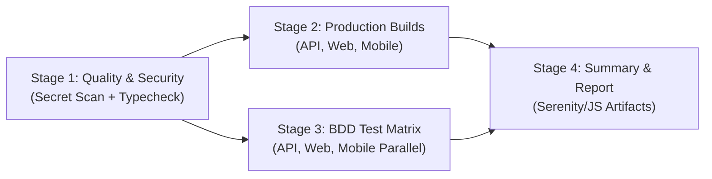

# Charlotte Wealth

[](https://www.typescriptlang.org/)
[](https://angular.dev/)
[](https://ionicframework.com/)
[](https://nestjs.com/)
[](https://tailwindcss.com/)
[](https://playwright.dev/)
[](https://appium.io/)
[](https://cucumber.io/)
[](https://serenity-js.org/)

Private Wealth Management Platform built with modern web, mobile, and backend architectures, featuring an enterprise-grade **Behavior-Driven Development (BDD)** testing suite adhering to Screenplay principles, Playwright, Appium 3, and Serenity/JS living documentation.

---

## 🏛️ Monorepo Topology

```text
charlotte-wealth/
├── .agents/
│   └── skills/                  # Centralized Agent Skills catalog
│       ├── cucumber-bdd/        # Industry-standard Gherkin & BDD best practices
│       ├── e2e-testing/         # Serenity/JS Screenplay & centralized test suite
│       ├── mobile-appium/       # Appium 3 & WebdriverIO 10 mobile automation
│       ├── monorepo-workflow/   # Workspace & parallel dev server orchestration
│       ├── angular-development/ # Standalone components, Signals, Tailwind CSS v4
│       └── nestjs-api/          # NestJS 11 backend REST API architecture
│
├── apps/
│   ├── web/                     # Angular 21 Standalone + Tailwind CSS v4 (Port: 4200)
│   │   ├── src/app/             # Portfolio dashboard, holdings, analytics, tools
│   │   └── src/styles.css       # Tailwind CSS v4 theme directives
│   │
│   ├── mobile/                  # Ionic 9 + Angular 22 Standalone + Capacitor 8 (Port: 8100)
│   │   ├── src/app/components/  # Mobile dashboard, holdings, analytics, tools
│   │   └── capacitor.config.ts  # Capacitor native configuration
│   │
│   ├── api/                     # NestJS 11 REST API (Port: 3000)
│   │   ├── src/app.controller.ts # Root, health, security, and portfolio routes
│   │   ├── src/app.service.ts   # Wealth calculation, FIFO lots, TVM & simulators
│   │   └── src/main.ts          # Bootstrap with CORS and security headers
│   │
│   └── e2e/                     # Centralized Test Suite (Web, API, Mobile)
│       ├── features/            # Cucumber Gherkin features grouped by functional area
│       │   ├── api/             # 6 API feature files (42 scenarios)
│       │   ├── web/             # 6 Web feature files (41 scenarios)
│       │   └── mobile/          # 4 Mobile feature files (25 scenarios)
│       ├── features/step_definitions/ # Serenity/JS Screenplay step definitions
│       ├── features/support/    # Playwright browser lifecycle & Serenity cast
│       ├── playwright/          # Playwright Web Page Object model
│       ├── appium/              # Appium 3 / WDIO 10 drivers, configs, page objects
│       ├── cucumber.js          # Cucumber profiles (api, web, mobile, smoke, regression)
│       └── target/              # Serenity/JS reports and Cucumber HTML reports
│
├── package.json                 # Monorepo workspaces definition
├── AGENTS.md                    # Universal Agent specification (OpenAI Codex standard)
├── GEMINI.md                    # Google Gemini & Antigravity instructions
├── CLAUDE.md                    # Anthropic Claude agent instructions
├── .cursorrules                 # Cursor IDE system instructions
└── README.md
```

---

## 🛠️ Tech Stack & Domain Architecture

| Domain | Technology | Description |
| :--- | :--- | :--- |
| **Frontend (Web)** | **Angular 21 + Tailwind CSS v4** | Standalone Components (`imports: [...]`), reactive Signals state (`signal`, `computed`), Zoneless change detection, dark-mode private wealth banking UI. |
| **Frontend (Mobile)** | **Ionic 9 + Angular 22 + Capacitor 8** | Cross-platform iOS/Android mobile client with touch-friendly wealth cards, sub-view selectors, and financial modeling tools. |
| **Backend API** | **NestJS 11** | High-performance modular REST API with CORS support, API key authentication, FIFO share lots engine, and Time Value of Money mathematical solvers. |
| **Acceptance & E2E Testing** | **Serenity/JS 3 + Cucumber 11 + Playwright 1.64** | Centralized in `apps/e2e`. Screenplay pattern actors, interactions, and questions for Web and REST API specifications. |
| **Mobile Automation** | **Appium 3 + WebdriverIO 10** | Native and hybrid mobile automation with **UiAutomator2** (Android), **XCUITest** (iOS), and automatic browser fallback. |
| **Living Documentation** | **Serenity BDD + Cucumber HTML** | Automated failure photography, step-by-step Screenplay audit trails, and HTML living documentation. |

---

## ✨ Platform Feature Matrix

* **Executive Dashboard**: Consolidated net worth, total unrealized gain/loss, asset class breakdown, privacy masking mode, theme toggle (`dark` / `light`), and multi-currency display (`USD`, `THB`, `SGD`).
* **Holdings & FIFO Share Lots**: Multi-asset tracking across U.S. Equities, Thai Equities, Cryptocurrencies, and Mutual Funds with detailed First-In-First-Out purchase lot cost basis auditing.
* **Portfolio Analytics & Allocation**: Real-time asset allocation drift analysis, target vs actual rebalancing models, historical performance tracking, and risk metrics (Sharpe ratio, volatility).
* **Dividend Calendar & Cashflows**: Monthly income forecasts, asset class dividend filtering, yield on cost metrics, and ex-dividend date tracking.
* **Transaction History**: Real-time trade log, symbol combobox filters, and category-level transaction auditing.
* **Financial Modeling Toolkit**:
  - **Average Cost Simulator**: Multi-step buy/sell modeling on existing or hypothetical positions.
  - **Target Cost Solver**: Mathematical solver calculating required share count and capital outlay to hit a target average price.
  - **Time Value of Money (TVM) Solver**: Projection engine solving for `FV` (Future Value), `PV` (Present Value), `PMT` (Payment), or `NPER` (Periods) with compounding schedules.
  - **Asset Allocation Rebalancer**: Inflow-based ("No-Sell") and standard buy/sell rebalancing planners.

---

## 🚀 Getting Started

### Prerequisites
- **Node.js**: `v20+` or `v24+` (Tested on `v24.19.0`)
- **npm**: `v10+` or `v11+`

---

### Quick Start: Launch All Services

From the monorepo root:

```bash
# Concurrently start NestJS API (3000), Angular Web (4200), and Ionic Mobile (8100)
npm start
```

| Service | Port | Local URL |
| :--- | :--- | :--- |
| **NestJS Backend API** | `3000` | [http://localhost:3000](http://localhost:3000) |
| **Angular Web Application** | `4200` | [http://localhost:4200](http://localhost:4200) |
| **Ionic Mobile Application** | `8100` | [http://localhost:8100](http://localhost:8100) |

---

### Running Individual Services

```bash
# Start API only (NestJS)
npm run start:api

# Start Web application only (Angular)
npm run start:web

# Start Mobile application only (Ionic dev server)
npm run start:mobile
```

### Building Application Bundles

```bash
# Compile production bundles for all projects (API, Web, Mobile)
npm run build:all

# Or compile selectively
npm run build:api
npm run build:web
npm run build:mobile
```

---

## 🧪 Centralized Testing Suite (`apps/e2e`)

All acceptance, end-to-end, API contract, and mobile automation tests are **strictly centralized** in [`apps/e2e`](file:///c:/dev/charlotte-wealth/apps/e2e). No test harnesses are duplicated inside `apps/web` or `apps/mobile`.

### Technology Stack
- **Web & API Engine**: **Playwright** (`@playwright/test` and `@serenity-js/playwright`)
- **Mobile Engine**: **Appium 3** & **WebdriverIO 10** (`appium-uiautomator2-driver`, `appium-xcuitest-driver`)
- **Framework & BDD**: **Cucumber 11** with BRIEF principles and declarative Gherkin
- **Reporting**: **Serenity/JS** Screenplay pattern with failure photography and living HTML documentation

---

### Feature Suites Grouped by Functional Area

The test suite contains **16 `.feature` files** comprising **108 scenarios**:

```text
apps/e2e/features/
├── api/                                 # API Contracts & Backend Logic (42 Scenarios)
│   ├── health_and_security.feature      # Health probe, DB check, API key security
│   ├── portfolio_holdings.feature       # Consolidated positions, FIFO share lots
│   ├── portfolio_analytics.feature      # Asset allocation math, rebalance metrics
│   ├── portfolio_dividends.feature      # Dividend schedule, currency parameterization
│   ├── market_data.feature              # Quotes, exchange rates, currency conversion
│   └── financial_tools.feature          # Trade simulator, target cost solver, TVM engine
│
├── web/                                 # Web Dashboard & Portfolios (41 Scenarios)
│   ├── dashboard.feature                # Executive summary, currency switch, privacy mode
│   ├── holdings.feature                 # Category tabs, symbol search, FIFO lots view
│   ├── analytics.feature                # Allocation charts, performance, risk metrics
│   ├── dividends.feature                # Dividend calendar, cashflow projections
│   ├── transactions.feature             # Transaction table, category filter, ticker search
│   └── tools.feature                    # Average cost, TVM, and rebalance simulators
│
└── mobile/                              # Mobile Appium & Hybrid Specs (25 Scenarios)
    ├── mobile_dashboard.feature         # Mobile net worth card, theme toggle, privacy
    ├── mobile_holdings.feature          # Mobile category dropdown, search, position cards
    ├── mobile_analytics_and_dividends.feature # Mobile analytics tabs, dividend filters
    └── mobile_transactions_and_tools.feature  # Mobile trade feed, TVM solver, rebalance mode
```

---

### Canonical Testing Commands

| Task | Command | Description |
| :--- | :--- | :--- |
| **Run All E2E Tests** | `npm test` | Unified single-pass execution of all 108 scenarios |
| **Run All Test Suites** | `npm run test:all` | Sequentially runs API &rarr; Web &rarr; Mobile suites |
| **API Tests Only** | `npm run test:api` | Executes 42 API health, security, and contract specs (`@api`) |
| **Web Tests Only** | `npm run test:web` | Executes 41 Web dashboard, holdings, and tools specs (`@web`) |
| **Mobile Tests Only** | `npm run test:mobile` | Executes 25 Mobile specs via Appium / WDIO (`@mobile`) |
| **Headed Mode** | `npm run test:e2e:headed` | Executes tests with visible browser UI |
| **Native Appium Android**| `npm run test:mobile:appium:android` | Executes Android UiAutomator2 test specs |
| **Native Appium iOS** | `npm run test:mobile:appium:ios` | Executes iOS XCUITest test specs |
| **Appium Drivers** | `npm run appium:drivers` | Lists installed Appium drivers |
| **Strict Typecheck** | `npm run typecheck` | Strict TypeScript compilation across test suites |
| **Secret Leak Scanner** | `npm run scan:secrets` | Scans codebase for unmasked credentials or tokens |
| **Serenity Living Report**| `npm run test:e2e:report` | Compiles Serenity/JS HTML living documentation |

---

### Test Verification Summary

```text
================================================================================
Execution Summary

Consolidated Portfolio Holdings and FIFO Share Lots:  10 successful, 10 total
Core Service Health and API Security...............:   5 successful,  5 total
Portfolio Dividend Cashflows and Income Yield......:   6 successful,  6 total
Portfolio Performance Analytics and Breakdown......:   6 successful,  6 total
Market Price Feeds and Currency Rates..............:   5 successful,  5 total
Investor Modeling Tools and Financial Simulators...:  10 successful, 10 total
Executive Portfolio Dashboard (Web)................:   6 successful,  6 total
Portfolio Holdings and FIFO Share Lots View (Web)..:   8 successful,  8 total
Strategic Portfolio Analytics and Allocation (Web).:   4 successful,  4 total
Dividend Cashflow and Income Projections (Web).....:   7 successful,  7 total
Transaction History Feed and Trade Analysis (Web)..:   6 successful,  6 total
Investor Financial Tools and Simulators (Web)......:  10 successful, 10 total
Mobile Executive Dashboard (Mobile)................:   5 successful,  5 total
Mobile Holdings and FIFO Lots View (Mobile)........:   5 successful,  5 total
Mobile Portfolio Analytics and Income Yield (Mobile):  5 successful,  5 total
Mobile Transactions Feed and Financial Tools.......:  10 successful, 10 total

Total Scenarios: 108 | Success Rate: 100% | Total Execution Time: ~1m 05s
================================================================================
```

---

## 📊 Living Documentation & Reports

Test execution generates rich living documentation:

1. **Cucumber HTML Report**: Generated automatically at `apps/e2e/target/cucumber-report.html`.
2. **Serenity/JS Living Documentation**: Structured JSON events, step-by-step Screenplay activity logs, and failure screenshots stored in `apps/e2e/target/site/serenity/`.
3. **View Report**:
   ```bash
   npm run test:report --workspace=e2e
   ```

---

## 🚀 CI/CD Pipeline (GitHub Actions)

A multi-stage GitHub Actions workflow is configured in [`.github/workflows/ci.yml`](file:///.github/workflows/ci.yml):



### Pipeline Stages
1. **Security & Quality Gate**: Runs `npm run scan:secrets` to catch leaked credentials and `npm run typecheck` for strict TypeScript validation.
2. **Production Artifact Builds**: Compiles NestJS (`apps/api/dist`), Angular Web (`apps/web/dist/web`), and Ionic Mobile (`apps/mobile/www`), uploading build bundles as workflow artifacts.
3. **Centralized BDD Test Matrix**: Parallel headless executions across:
   - `test-matrix (api)`: 42 API health, FIFO share lot, TVM, and dividend scenarios.
   - `test-matrix (web)`: 41 Web dashboard, holdings, and analytics scenarios with Playwright Chromium.
   - `test-matrix (mobile)`: 25 Mobile app scenarios with responsive viewport emulation.
4. **Living Documentation & Photography**: Automatically uploads `cucumber-report.html` and Serenity/JS screenshot artifacts on every pull request and push to `main`.

### Configuring GitHub Secrets
Configure the following secrets under **Repository Settings > Secrets and variables > Actions**:
| Secret Name | Required For | Description |
| :--- | :--- | :--- |
| `BACKEND_API_KEY` | API & E2E Tests | 256-bit API key (defaults to development key if omitted in CI) |
| `SEC_SUBSCRIPTION_KEY` | API Live Feeds | Thailand SEC API subscription key |
| `GOOGLE_SPREADSHEET_ID` | Portfolio Data | Google Sheets source document ID |
| `GOOGLE_PVD_SPREADSHEET_ID` | PVD Data | Google Sheets PVD document ID |

---

## 🤹 AI Coding Agent Standards & Skills

Charlotte Wealth includes comprehensive context, skills, and rule sets for AI coding assistants:

| Agent / Ecosystem | Standard File | Description |
| :--- | :--- | :--- |
| **Codex (OpenAI)** | [`AGENTS.md`](file:///c:/dev/charlotte-wealth/AGENTS.md) | Universal Agent standard and monorepo invariants |
| **Gemini & Antigravity** | [`GEMINI.md`](file:///c:/dev/charlotte-wealth/GEMINI.md) | Antigravity CLI and Gemini workflow rules |
| **Claude (Anthropic)** | [`CLAUDE.md`](file:///c:/dev/charlotte-wealth/CLAUDE.md) | Instructions for Claude Code and Claude Desktop |
| **Cursor IDE** | [`.cursorrules`](file:///c:/dev/charlotte-wealth/.cursorrules) & [`.cursor/rules/`](file:///c:/dev/charlotte-wealth/.cursor/rules/) | Scoped MDC rules and system prompts |

### Centralized Skills Catalog (`.agents/skills`)

- [**`cucumber-bdd`**](file:///c:/dev/charlotte-wealth/.agents/skills/cucumber-bdd/SKILL.md): Industry-standard BDD authoring, BRIEF principles, declarative steps, and suite hygiene.
- [**`e2e-testing`**](file:///c:/dev/charlotte-wealth/.agents/skills/e2e-testing/SKILL.md): Serenity/JS Screenplay pattern, Playwright actors, and living reports.
- [**`mobile-appium`**](file:///c:/dev/charlotte-wealth/.agents/skills/mobile-appium/SKILL.md): Appium 3 & WebdriverIO 10 mobile automation and context switching.
- [**`monorepo-workflow`**](file:///c:/dev/charlotte-wealth/.agents/skills/monorepo-workflow/SKILL.md): Workspace management, parallel dev servers, and port assignments (3000, 4200, 8100).
- [**`angular-development`**](file:///c:/dev/charlotte-wealth/.agents/skills/angular-development/SKILL.md): Angular 21/22 Standalone Components, Signals, and Tailwind CSS v4.
- [**`nestjs-api`**](file:///c:/dev/charlotte-wealth/.agents/skills/nestjs-api/SKILL.md): NestJS 11 controllers, services, CORS policies, and wealth data models.
- [**`implementation-workflow`**](file:///c:/dev/charlotte-wealth/.agents/skills/implementation-workflow/SKILL.md): 6-phase engineering lifecycle: Baseline -> BDD -> Code -> Multi-Device Frontends -> Test Suite Review -> Documentation Sync.

---

## 🔒 Monorepo Invariants & Guardrails

1. **Centralized Testing**: All acceptance, E2E, API contract, and mobile Appium tests must remain strictly in `apps/e2e`. Never add duplicate test harnesses to `apps/web` or `apps/mobile`.
2. **Standard Port Assignments**: API is `3000`, Web is `4200`, Mobile is `8100`.
3. **No NgModules**: Frontend code must always use Angular Standalone Components and reactive Signals.
4. **Code Quality**: Follow strict TypeScript checking (`npm run typecheck --workspace=e2e`) and Prettier formatting at all times.

---

## 📄 License

Private & Proprietary. All rights reserved.
